<div align="center">

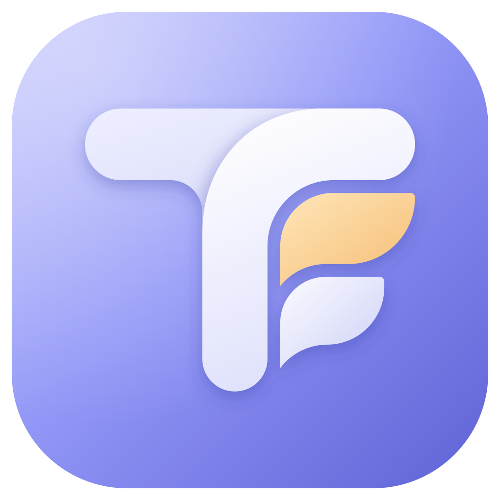

# TosmFi — Mobile

**Aplikasi pencatat keuangan pribadi TosmFi untuk Android & iOS.**
Dompet, budget, jadwal tagihan, investasi, laporan, dan Catat Cepat dengan AI (termasuk scan struk) — langsung dari HP.


<p>
  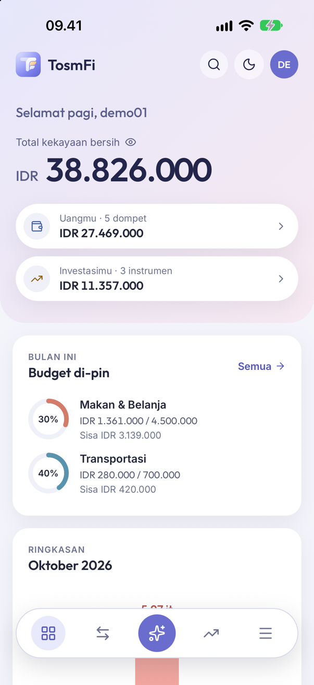
  &nbsp;
  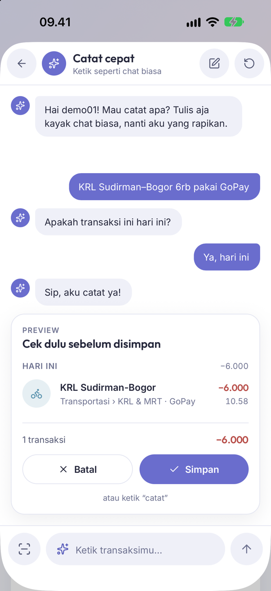
  &nbsp;
  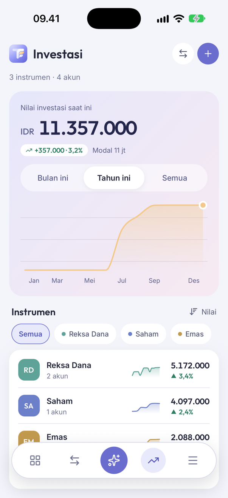
  &nbsp;
  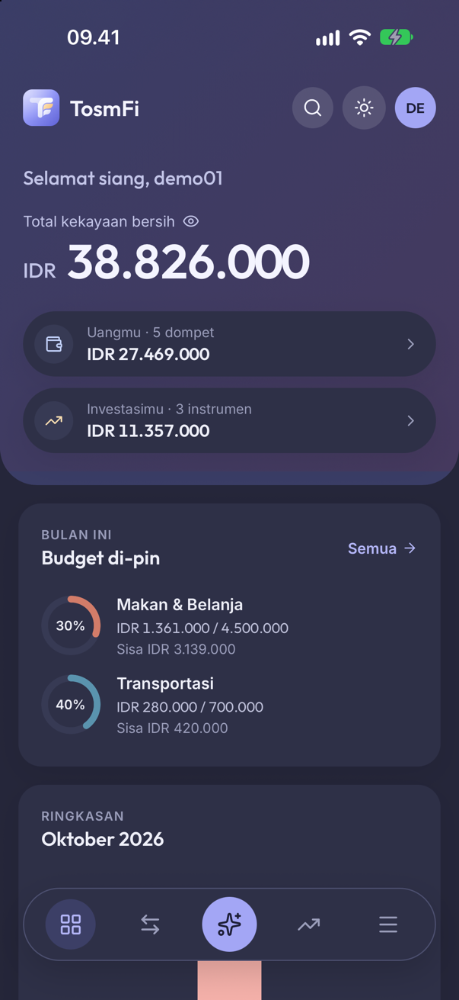
</p>

</div>

---

## 🔑 Akun demo

| Username | Password |
|---|---|
| `demo01` | `demo01` |

Akun yang sama bisa dipakai di web: **[tosm-fi.netlify.app](https://tosm-fi.netlify.app)**. Akun demo dipakai bersama, jadi jangan simpan data pribadi di sana. Reset Data, ganti username, dan ganti password dinonaktifkan untuk akun ini.

## 🧩 Ekosistem TosmFi

Web dan mobile memakai backend yang sama, jadi data yang dicatat di HP langsung muncul di web, dan sebaliknya.

| Repo | Peran | Stack | Link |
|---|---|---|---|
| [tosm-fi](https://github.com/riantosm/tosm-fi) | Web app (PWA) | React 19 · Vite · Tailwind | [tosm-fi.netlify.app](https://tosm-fi.netlify.app) |
| **[tosm-fi-app](https://github.com/riantosm/tosm-fi-app)** ← kamu di sini | Aplikasi mobile Android & iOS | React Native 0.87 | [Cara build](#-menjalankan--build) |
| [tosm-fi-be](https://github.com/riantosm/tosm-fi-be) | REST API + AI (Catat Cepat) | Express · MongoDB · Gemini | [tosm-fi-be.vercel.app](https://tosm-fi-be.vercel.app) |

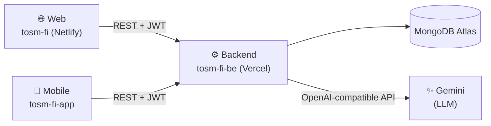

## 📸 Screenshot

Diambil dari simulator iPhone 18 Pro (iOS 27) dengan akun demo.

**Catat Cepat (AI)** — pilih contoh atau ketik bebas → AI menanyakan yang kurang → pratinjau sebelum disimpan.

<table>
  <tr>
    <td align="center">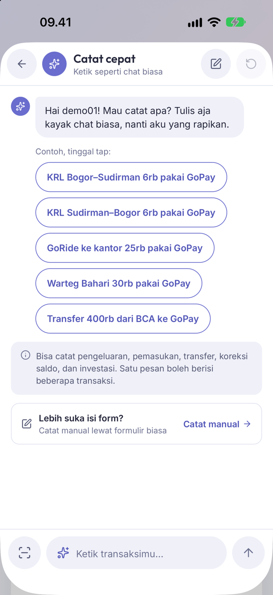<br/><sub>Contoh dari kebiasaanmu</sub></td>
    <td align="center">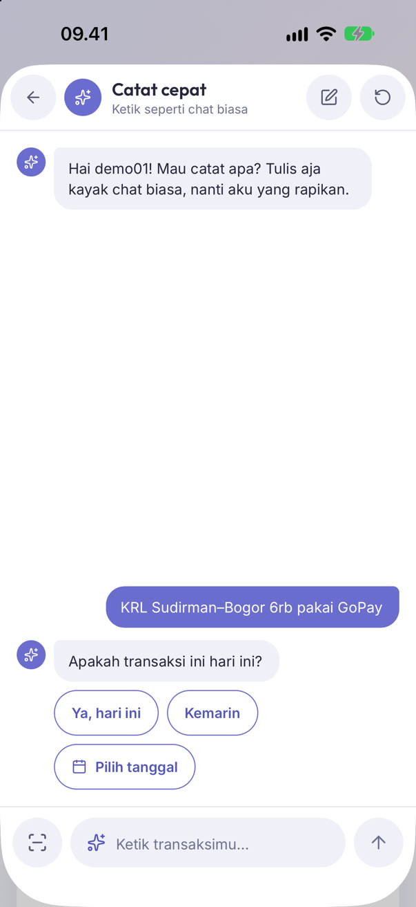<br/><sub>Bertanya kalau ada yang kurang</sub></td>
    <td align="center"><br/><sub>Pratinjau, lalu Simpan</sub></td>
  </tr>
</table>

**Halaman utama**

<table>
  <tr>
    <td align="center"><br/><sub>Beranda</sub></td>
    <td align="center">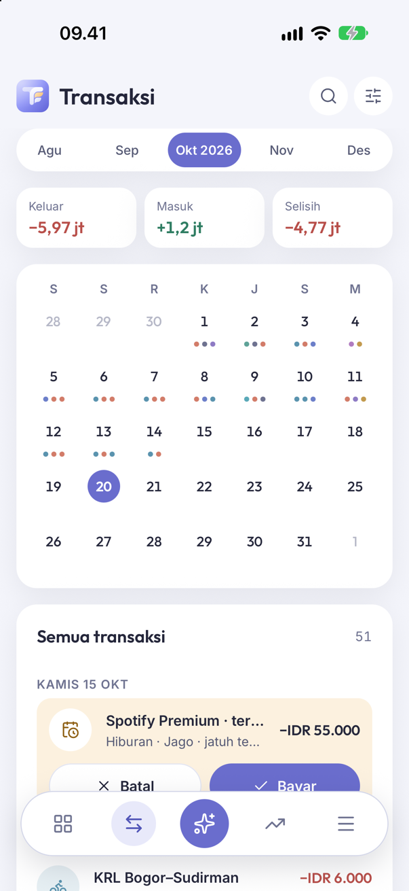<br/><sub>Transaksi + kalender</sub></td>
    <td align="center"><br/><sub>Investasi</sub></td>
  </tr>
  <tr>
    <td align="center">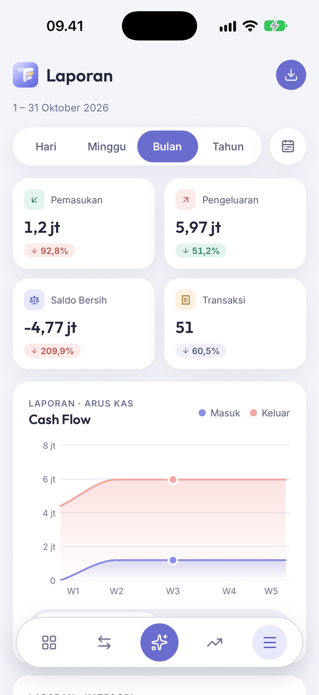<br/><sub>Laporan & export</sub></td>
    <td align="center">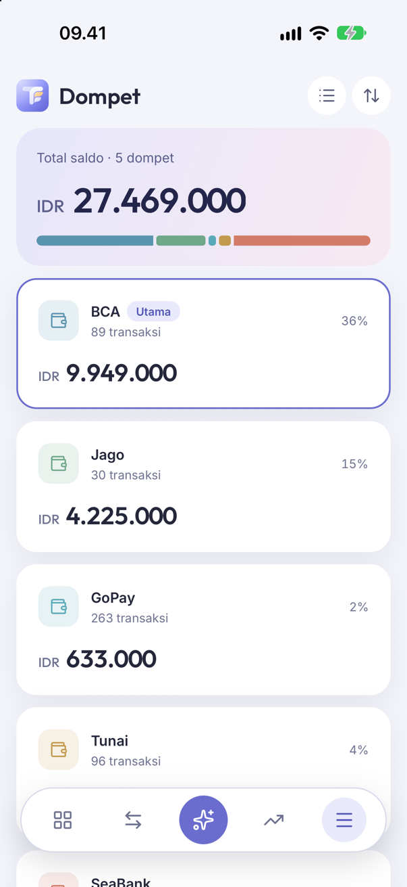<br/><sub>Dompet</sub></td>
    <td align="center">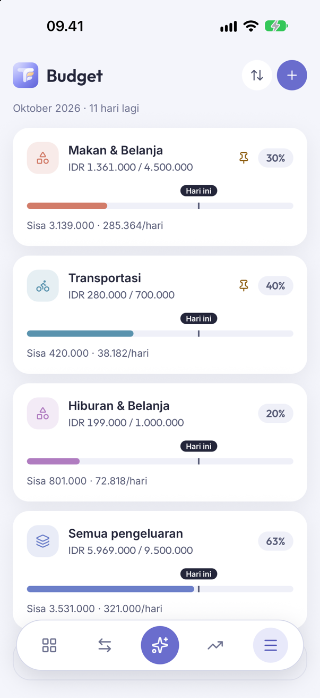<br/><sub>Budget</sub></td>
  </tr>
  <tr>
    <td align="center">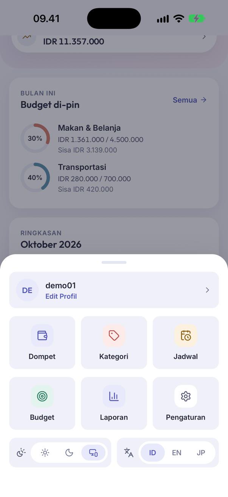<br/><sub>Menu Lainnya (tema & bahasa)</sub></td>
    <td align="center"><br/><sub>Tema gelap</sub></td>
    <td></td>
  </tr>
</table>

## ✨ Fitur

- **Beranda** — kekayaan bersih (bisa disembunyikan), budget yang di-pin, ringkasan bulan, kesehatan finansial, pengeluaran per kategori, dompet, dan transaksi bulan ini.
- **Transaksi** — kalender bertitik, filter (dompet, tipe, kategori, tanggal, urutan), pencarian, infinite scroll, bayar/batal tagihan.
- **Catat transaksi** — pemasukan, pengeluaran, transfer (tukar dompet sekali tap), koreksi saldo, kalkulator di input nominal, catat sekaligus sebagai investasi.
- **Dompet, Kategori, Budget, Jadwal** — warna custom (color wheel), drag-to-reorder, limit per kategori/subkategori, transaksi berulang.
- **Investasi** — grafik nilai vs modal, filter portofolio per instrumen, ledger, setor/tarik/transfer/update nilai bertanggal mundur.
- **Laporan** — periode fleksibel, cash flow, tren 12 bulan, top pengeluaran, dompet paling aktif; **export PDF / Excel / CSV** lewat share sheet.
- **Catat Cepat (AI)** + **Scan struk** — lihat di bawah.
- **Pengingat jadwal** — notifikasi lokal jam 08.00 di hari jatuh tempo (tanpa Firebase).
- **Kunci aplikasi (Android)** — sidik jari atau PIN 6 digit; pintasan Catat Cepat, Dompet, dan Transaksi 3 hari tetap bisa dibuka tanpa kunci.
- **Tema** Terang / Gelap / Ikuti sistem, **bahasa** Indonesia / English / 日本語, **mata uang** IDR / USD / JPY.
- **Admin** — persetujuan pengguna baru dan log error.

## 🤖 Catat Cepat (AI) & Scan Struk

Tombol AI di tengah bottom nav membuka chat. Tulis seperti biasa, misalnya *"tadi pagi KRL 6rb, siang makan 25rb pakai GoPay"*, lalu AI menyusun draft transaksi, menanyakan yang kurang lewat tombol jawaban cepat, dan menampilkan pratinjau. Data baru tersimpan setelah kamu menekan **Simpan** (atau mengetik "catat").

**Scan struk**: tekan ikon kamera di kolom chat, foto struk, lalu AI membaca merchant, total setelah diskon, tanggal, item (masuk ke catatan), dan metode pembayaran. Foto diperkecil ke 1280px JPEG sebelum dikirim.

| | |
|---|---|
| **Model** | Google **Gemini** (`gemini-3.8-flash` + fallback Flash/Flash-Lite), multimodal untuk foto struk |
| **Jalur** | App → [`tosm-fi-be`](https://github.com/riantosm/tosm-fi-be) `POST /assistant/chat` & `/assistant/commit` → Gemini. API key hanya ada di server. |
| **Keamanan data** | Model tidak pernah melihat ID database; setiap draft divalidasi ulang di server sebelum disimpan dalam satu transaksi database. |

Detail LLM ada di [README backend](https://github.com/riantosm/tosm-fi-be#-ai--llm).

## 🛠️ Tech stack

| Kategori | Teknologi |
|---|---|
| Framework | React Native 0.87 (CLI, New Architecture), React 19.2, TypeScript 6 |
| Navigasi | React Navigation 7 (native stack + bottom tabs, bottom nav custom) |
| State | Redux Toolkit + redux-persist (AsyncStorage) |
| HTTP | Axios (Bearer JWT, auto-logout saat 401) |
| Animasi | Reanimated 4, react-native-worklets, Moti |
| Grafik | react-native-svg (area chart, donut, sparkline buatan sendiri) |
| Kamera | react-native-vision-camera 5 + Nitro Modules / nitro-image |
| Notifikasi | @notifee/react-native (lokal) |
| Biometrik | TurboModule native sendiri (`NativeAppLock`, AndroidX Biometric + PBKDF2) |
| Export | jsPDF + autotable, SheetJS `xlsx`, react-native-share |
| i18n | i18next + react-i18next + react-native-localize |
| Ikon | lucide-react-native |
| Env | react-native-config |

## 🏗️ Struktur

```
src/
├── screens/        # satu folder per layar (Dashboard, Transactions, QuickAdd, ScanReceipt, …)
├── navigation/     # RootNavigator, MainTabNavigator, AppBottomNav, ROUTES
├── components/     # atomic design: atoms / molecules / organisms / templates
├── hooks/          # useAuth, useWallets, useReports, useAssistantChat, useAppLock, …
├── services/       # api/ (axios + service per domain), native/, notification/
├── store/          # Redux slices + persist
├── contexts/       # Theme, Toast, AssistantChat, …
├── theme/          # token warna light/dark, tipografi, spacing, shadow
├── i18n/           # id / en / jp
├── specs/          # spec TurboModule (codegen)
└── utils/          # format, chart, reportExport, schedule, assistantExamples, …
```

Tampilan mengikuti sistem desain "Mist" yang sama dengan web — lihat [`DESIGN_SYSTEM.md`](DESIGN_SYSTEM.md). Konvensi kode di [`PROJECT_CONVENTIONS.md`](PROJECT_CONVENTIONS.md), arsitektur detail di [`CLAUDE.md`](CLAUDE.md).

## 🚀 Menjalankan & build

Prasyarat: Node.js ≥ 22.11, JDK 17 + Android Studio (Android), Xcode + CocoaPods (iOS). Lihat [panduan environment React Native](https://reactnative.dev/docs/set-up-your-environment).

```bash
git clone https://github.com/riantosm/tosm-fi-app.git
cd tosm-fi-app
npm install
cp .env.example .env
cd ios && bundle install && bundle exec pod install && cd ..
```

| Variabel | Keterangan |
|---|---|
| `API_BASE_URL` | Default backend produksi `https://tosm-fi-be.vercel.app/api`. Backend lokal: `http://10.0.2.2:3000/api` (emulator Android) atau `http://localhost:3000/api` (simulator iOS). Perubahan `.env` butuh rebuild native. |

| Script | Fungsi |
|---|---|
| `npm start` | Metro bundler |
| `npm run android` / `npm run ios` | Jalankan di emulator/simulator/device |
| `npm run android-d` | Build APK debug (`com.tosm.finance.debug`, "TosmFi Dev") |
| `npm run android-r` | Build APK release (R8 + resource shrinking, ±24 MB) |
| `npm run lint` · `npx tsc --noEmit` | Lint & type-check |

APK hasil build otomatis tersalin ke `documentation/` sebagai `TosmFi-v<versi>(<code>)-<buildType>.apk`. Catatan rilis ada di [`documentation/CHANGELOG.md`](documentation/CHANGELOG.md).

---

<div align="center">
<sub>© 2026 TosmFi · <a href="https://github.com/riantosm/tosm-fi">Web</a> · Mobile · <a href="https://github.com/riantosm/tosm-fi-be">Backend</a></sub>
</div>
